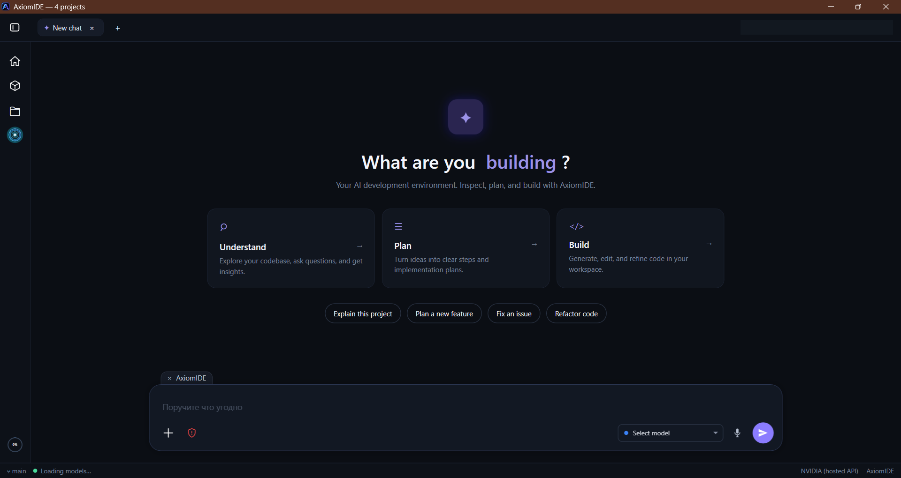
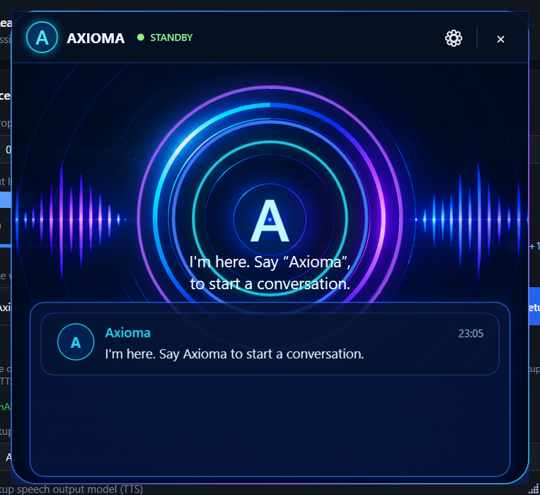
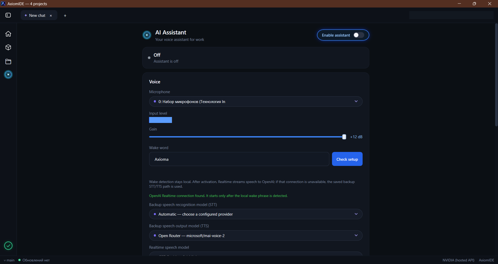
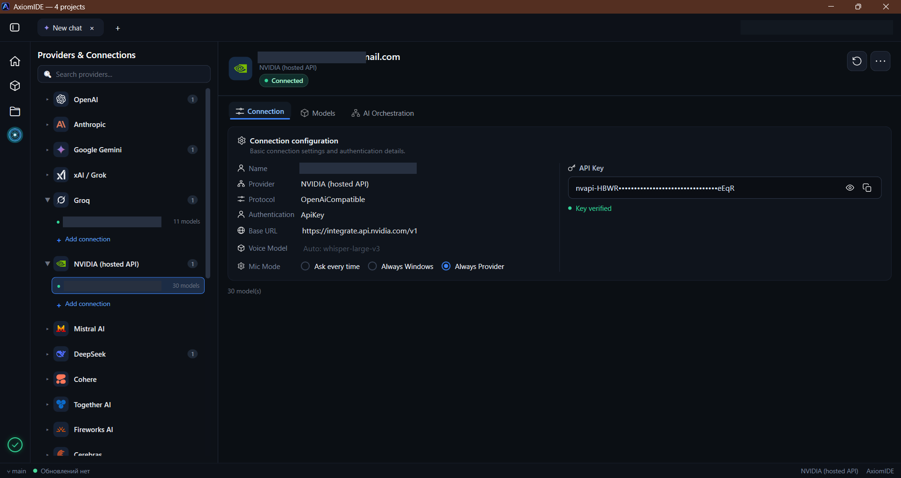
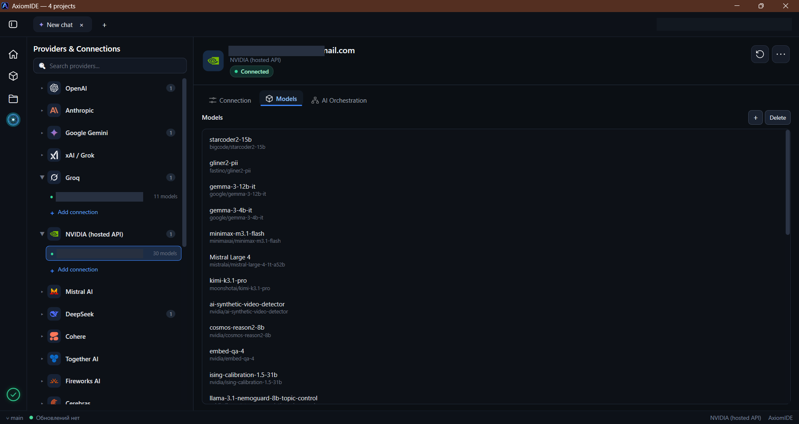
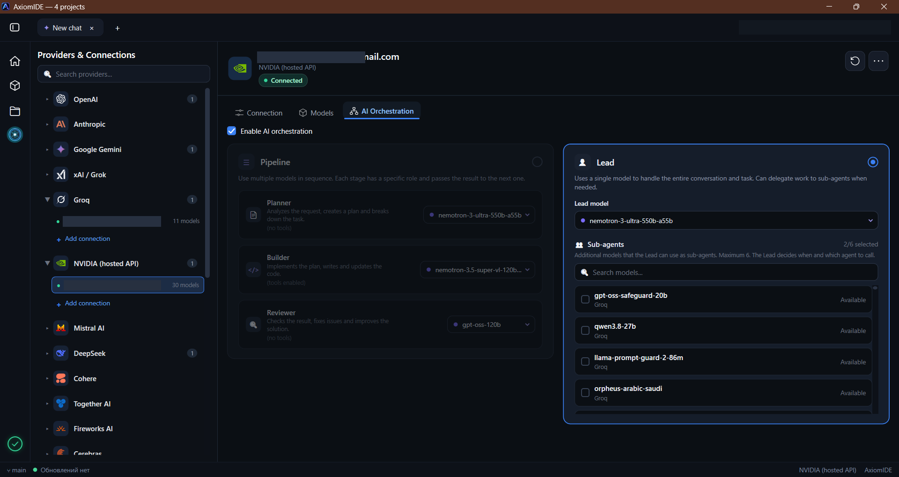

<details>
<summary><strong>📸 VIEW SCREENSHOTS (6) — CLICK TO OPEN</strong></summary>

<h3>💻 AxiomIDE — Application Screenshots</h3>

<p><strong>🏠 Main Workspace</strong></p>
<p></p>

<p><strong>🎙️ Axioma Voice Assistant</strong></p>
<p></p>

<p><strong>⚙️ AI Assistant Settings</strong></p>
<p></p>

<p><strong>🔌 AI Providers &amp; Connections</strong></p>
<p></p>

<p><strong>🧠 AI Model Management</strong></p>
<p></p>

<p><strong>🤖 Multi-Agent AI Orchestration</strong></p>
<p></p>

</details>

# 🧠 Axiom AI

### Local AI Development Environment • Multi-Model Orchestration • Autonomous Agents • Controlled Execution

**Axiom AI** is a desktop AI-powered development environment designed to go beyond traditional AI chat interfaces and code assistants.

It brings together AI model orchestration, specialized agent workflows, project interaction, development tools, execution control, and result verification within a unified local workspace.

Rather than treating artificial intelligence as a simple text-generation service, Axiom AI is designed around a more structured approach:

**AI models reason and propose actions. The application controls how those actions are executed, authorized, and verified.**

---

## 🚀 What Is Axiom AI?

Modern AI-assisted development involves much more than generating code.

Real software engineering requires understanding existing projects, examining source files, coordinating changes, running development tools, diagnosing failures, and verifying that modifications produce the intended results.

Axiom AI brings these activities into a single environment.

The application is designed to support workflows involving:

- Multiple AI models with different capabilities.
- Specialized AI agents working on development tasks.
- Project and workspace interaction.
- File inspection and modification.
- Development command execution.
- Build and test workflows.
- Controlled access to local tools.
- Permission-aware operations.
- Verification of AI-generated changes.
- Structured development workflows.

Axiom AI aims to bridge the gap between conversational AI and practical software engineering.

---

## 🏗️ Core Architecture

Axiom AI is built around several cooperating components.

### 🧠 AI Model Layer

The model layer provides access to AI capabilities through a provider-independent architecture.

Different models can be selected for different tasks, allowing development workflows to use specialized reasoning, coding, analysis, or review capabilities.

The architecture is designed to avoid making the entire application dependent on a single AI provider.

### 🤖 Agent Orchestration

Agent-oriented workflows organize development tasks into specialized responsibilities.

Instead of requiring one model to perform every operation, the system is designed to coordinate multiple agents within a controlled development process.

This approach separates responsibilities such as analysis, implementation, and verification.

### ⚙️ Execution Runtime

The execution runtime connects AI decisions to application capabilities.

It provides the architectural boundary between a model requesting an operation and the software actually performing that operation.

This separation is fundamental to the system.

AI-generated instructions are not equivalent to unrestricted access to the operating system.

### 🛡️ Permission and Control Layer

Local development tools can access sensitive resources, including project files and executable commands.

Axiom AI incorporates permission-aware tool execution to distinguish AI requests from authorized operations.

The goal is to provide useful automation without treating model output as inherently trusted.

### 🔍 Verification Layer

Generating a code modification is only part of a development task.

Axiom AI emphasizes checking the result through available development operations, including build and test workflows.

The objective is to make AI-assisted changes more observable and verifiable.

---

## 🧠 AI Interaction Modes

Axiom AI supports different approaches to AI-assisted work.

### 💬 Chat

Direct interaction with an AI model for development discussions, technical questions, code analysis, and problem-solving.

```text
User
  |
  v
Selected AI Model
  |
  v
Response
```

### 🤖 Agent-Based Development

A more structured workflow in which AI capabilities interact with available development tools and project resources.

```text
User Request
     |
     v
AI Agent
     |
     v
Tool Request
     |
     v
Permission Evaluation
     |
     v
Authorized Execution
     |
     v
Tool Result
     |
     v
AI Evaluation
```

### 🧩 Multi-Agent Coordination

Complex development tasks can benefit from distributing responsibilities across specialized agents and models.

```text
             User Task
                 |
                 v
        Agent Coordination
                 |
       +---------+---------+
       |         |         |
       v         v         v
    Analysis  Development  Review
       |         |         |
       +---------+---------+
                 |
                 v
         Result Evaluation
```

These diagrams illustrate the architectural concepts rather than guaranteeing a specific execution sequence for every task.

---

## ✨ Key Capabilities

### 🌐 Multi-Model AI Integration

Axiom AI is designed to support multiple AI providers and models through a unified application architecture.

This enables model selection based on the requirements of a particular development task.

### 👥 Specialized AI Agents

Agent-based workflows help organize complex software engineering activities into manageable responsibilities.

The system is designed to support coordinated work rather than relying exclusively on isolated conversations.

### 📁 Project and Workspace Operations

Axiom AI connects AI-assisted workflows with local development resources.

This includes working with project structures and file operations through application-controlled tools.

### 🛠️ Development Tool Integration

The application incorporates development-oriented tool execution capabilities.

These capabilities can support operations such as inspecting project files, executing permitted commands, and obtaining diagnostic information.

### 🧪 Build, Test, and Verification

Axiom AI emphasizes verification as part of the development process.

Available build and test tools can provide feedback about compilation errors, test failures, and the results of development changes.

### 🔐 Controlled Tool Execution

Tool requests are evaluated through application-level execution and permission mechanisms.

This design helps maintain a boundary between AI-generated actions and operations performed on the user's computer.

### 🖥️ Local Desktop Environment

Axiom AI operates as a desktop development environment, integrating AI capabilities with local project workflows.

The application provides a unified workspace for interacting with AI models and development tools.

---

## 🔄 AI-Assisted Development Workflow

A typical development workflow may involve:

1. **Task Definition** — The user describes a development objective.
2. **Project Analysis** — Available tools are used to examine relevant project resources.
3. **Planning** — AI reasoning identifies an implementation approach.
4. **Controlled Execution** — Requested tool operations pass through the application's execution and permission mechanisms.
5. **Implementation** — Authorized changes are applied through available development tools.
6. **Verification** — Build, test, or inspection results are evaluated.
7. **Result Review** — The user reviews the outcome and determines the next action.

The workflow is intended to make AI-assisted software development more structured, transparent, and controllable.

---

## 🎯 Design Philosophy

Axiom AI is guided by several engineering principles.

**AI should assist development, not replace execution control.**

Model-generated actions must remain distinguishable from authorized application operations.

**Different models can serve different purposes.**

The architecture should support choosing AI capabilities based on task requirements rather than forcing every workflow through a single provider.

**Verification matters.**

Generated code should be evaluated through appropriate development checks instead of being accepted solely because an AI model produced it.

**Local project control is essential.**

The user should remain in control of their workspace, files, and development environment.

**Extensibility matters.**

AI providers, development tools, and execution capabilities should be able to evolve without requiring the entire application to be redesigned.

---

## 💻 Intended Use Cases

Axiom AI is designed for development activities such as:

- AI-assisted software engineering.
- Existing codebase investigation.
- Technical analysis and debugging.
- Coordinated AI coding workflows.
- Development task decomposition.
- File and project operations.
- Build and test execution.
- Reviewing and verifying implementation results.
- Experimenting with different AI models and agent workflows.

---

## 🔒 Security and Execution Boundaries

AI-generated tool requests can affect local files and development resources.

Axiom AI therefore treats execution control as an important architectural responsibility.

The application uses permission-aware mechanisms to govern access to supported tools.

These mechanisms are intended to reduce uncontrolled execution, but they do not guarantee that AI-generated actions or code are free from errors or security risks.

Users should review consequential operations and maintain appropriate backups of important projects.

---

## 📦 Distribution

Official Axiom AI releases are distributed through GitHub.

[**GitHub Releases — Axiom AI**](https://github.com/Roman-git-hub/Axiom-IDE/releases)

Development capabilities and supported integrations may evolve between releases.

---

## 📄 License

Axiom AI is distributed as freeware under a proprietary license.

Official binary releases may be downloaded, installed, and used free of charge for personal and commercial purposes.

Copyright © 2026 Roman-git-hub. All rights reserved.

See [LICENSE](LICENSE) for the complete terms.

Third-party libraries, AI providers, models, and external services remain subject to their respective licenses and terms.

### 🔒 Official Distribution & Security

Official Axiom AI releases are distributed through this GitHub repository.

Modified, repackaged, or third-party distributions are not authorized by the developer and must not be represented as official releases.

For your security, obtain the application from the official [GitHub Releases](https://github.com/Roman-git-hub/Axiom-IDE/releases) page.

---

**Axiom AI — Beyond AI Chat. Structured Intelligence for Software Development.**
